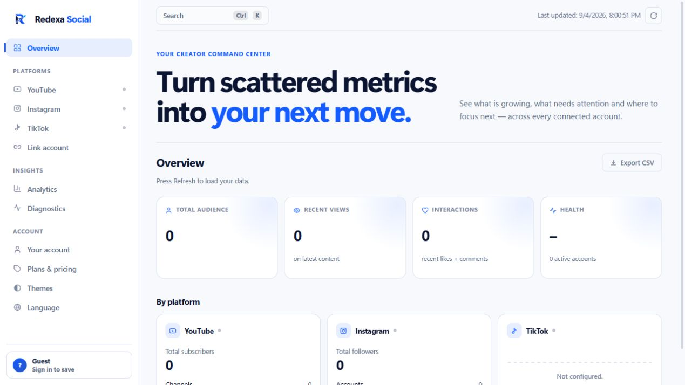

# Redexa Social — Private YouTube Analytics for Windows

For creators reviewing their own channel performance. Turn connected-account data into content rankings, diagnostic findings and local reports. Analytics history stays on the PC; platform and account requests still use their respective services.

[Product](https://redexa.getcertsprint.com/) · [Official Windows downloads](https://github.com/AurelioAvila/redexa-social/releases/latest) · [Verify the publisher signature](https://github.com/AurelioAvila/.github/blob/master/CODE_SIGNING.md)

**Example workflow:** connect your own YouTube channel → review the content-ranking and diagnostic tables → export the collected analytics as CSV on Pro or Studio. This is an analytics workflow; the app does not publish or schedule posts.

[](https://github.com/AurelioAvila/redexa-social/releases/latest) [](https://github.com/microsoft/winget-pkgs/tree/master/manifests/a/AurelioAvila/SocialDashboard)

[Download the latest signed release](https://github.com/AurelioAvila/redexa-social/releases/latest) · [Official website](https://redexa.getcertsprint.com) · [Getting started](https://redexa.getcertsprint.com/getting-started) · [Plans](https://redexa.getcertsprint.com/pricing)



## What it does

- **Single overview.** Start with YouTube analytics. Add Instagram and TikTok with your own developer app and compare trends across connected accounts.
- **Content ranking.** Review your top-performing posts and compare views per post against your own average.
- **Diagnostics, not just numbers.** Flags stalled accounts, zero-view content and access problems, each with a concrete next step. Missing data is not the same as zero performance.
- **Automatic insights.** Computed locally from your own data, without sending analytics to an external AI service or charging for AI calls.
- **Posting windows and CSV export** (Pro and Studio). A 24-hour chart of posting windows based on the data you collected, and spreadsheet export.
- **12 themes and 6 languages:** English, Spanish, French, German, Italian and Japanese.

Redexa Social reads analytics only. It has no posting, scheduling or automation features and requests no publishing permissions. It complements YouTube Studio; it does not replace every native report.

## Requirements

- Windows 10 or 11, 64-bit.
- A YouTube channel you own or manage. Instagram and TikTok currently require your own developer app. X shows credential status only; X analytics are not available.

## Plans

| | Free | Pro | Studio |
|---|---|---|---|
| Connected accounts | 1 | 3 | 10 |
| Overview, content ranking, diagnostics, local insights | Yes | Yes | Yes |
| Stored history and trend charts | No | Yes | Yes |
| 24-hour posting-window chart | No | Yes | Yes |
| Rivals: compare with up to 3 public channels | No | Yes | Yes |
| CSV export | No | Yes | Yes |
| Computers per licence | No key needed | 3 | 5 |

The free plan is permanent and needs no licence key. Current prices and billing details are on the [pricing page](https://redexa.getcertsprint.com/pricing).

## Install

### Official download locations

Aurelio Avila publishes Redexa Social at [redexa.getcertsprint.com](https://redexa.getcertsprint.com/). The [official download page](https://redexa.getcertsprint.com/download) uses **dl.pctweaker.app/redexa-social/**, the publisher's download host shared with the PC Tweaker suite. This is an authorized distribution location for Redexa Social, including the portable ZIP used by WinGet.

For version **1.11.1**, the official portable package is [Redexa-Social-v1.11.1-win64.zip](https://dl.pctweaker.app/redexa-social/v1.11.1/Redexa-Social-v1.11.1-win64.zip). Its SHA-256 is:

```text
6d9e9eed19248f3d57fb64b898af659853f1fa26cbe1fbb3347bf6c7bebd8a6b
```

The same package is retained in the [1.11.1 GitHub release](https://github.com/AurelioAvila/redexa-social/releases/tag/v1.11.1), with a checksum file. Match the checksum and verify the packaged executables before running them. A matching hash identifies the file; it does not establish that a download is safe on its own.

### Setup, portable or WinGet

Download [`Redexa-Social-Setup.exe`](https://github.com/AurelioAvila/redexa-social/releases/latest/download/Redexa-Social-Setup.exe) and run it. It installs for your Windows account in `%LOCALAPPDATA%\Programs\Redexa Social` with no administrator prompt; the last page offers **Run Redexa Social** and **Create a desktop shortcut**, both ticked, and a Start menu shortcut is always added. Uninstall from **Settings > Apps**; your data in `%APPDATA%\RedexaSocial` stays.

Prefer a portable copy? Download the Windows ZIP from the [latest release](https://github.com/AurelioAvila/redexa-social/releases/latest), extract the whole archive and open `Redexa Social.exe`. Or use WinGet:

```powershell
winget install --id AurelioAvila.SocialDashboard --exact
```

The WinGet badge reflects accepted manifests. The downloadable catalog and local clients may lag behind a newly merged update. Run `winget source update --name winget`, then `winget show --id AurelioAvila.SocialDashboard --exact --source winget` to check the version available to your client. Use the latest signed GitHub release if the catalog still shows an earlier version.

## Verify what you download

Official updates use signed manifests and Windows binaries signed by Aurelio Avila. Before the first run, open the installer's **Digital Signatures** tab and check the publisher, signature validity and trusted timestamp. For a portable ZIP, check the executable inside it. Follow the [release verification guide](https://github.com/AurelioAvila/.github/blob/master/CODE_SIGNING.md) for the current release. A signature does not guarantee that SmartScreen will show no warning. Older downloads may be unsigned.

## Privacy

Analytics history and saved account credentials are stored on your PC. Local-first does not mean offline: the app requests statistics from connected platforms, and remote services process purchases, licence verification, transactional email and update checks. Product-provided Instagram and TikTok authorization uses a token-exchange service; when you supply your own developer app, the exchange runs directly between your PC and the platform. These flows do not upload your analytics history to Redexa Social.

The website counts anonymous daily actions without tracking cookies or visitor identifiers. Read the [privacy policy](https://redexa.getcertsprint.com/privacy) for the data handled by each service and the [data deletion instructions](https://redexa.getcertsprint.com/data-deletion) for local and remote records. You can revoke YouTube access in your Google account settings; uninstalling the app keeps its local data folder.

## About this repository

This repository hosts Windows downloads, release notes, public documentation and the release verification tools. Application development continues in a private repository. Existing source snapshots remain available in historical branches, tags and forks; future application source is not published here.

## Support

For private support or billing questions, email [redexasocial@getcertsprint.com](mailto:redexasocial@getcertsprint.com) or use **Help & support** inside the app. For a reproducible, non-sensitive bug, [open an issue](https://github.com/AurelioAvila/redexa-social/issues). Never include passwords, access tokens or private analytics in public issues.

See also the [terms](https://redexa.getcertsprint.com/terms) and the [license](LICENSE).
